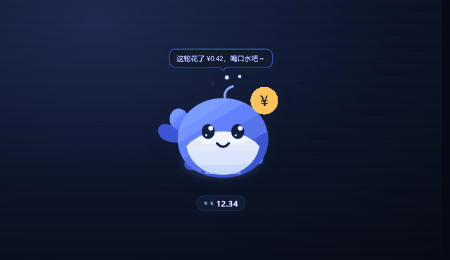

# 小鲸鱼余额挂件（dsh-balance-whale）

[](https://github.com/CLxingxi/dsh-balance-whale/actions/workflows/smoke.yml)



一只住在 DeepSeek Harness Web 界面里的 Q 弹小鲸鱼：常驻显示 DeepSeek 账户余额，按工作状态切换表情，
会说小气泡，会发出可爱的音效，并帮你记账（今日已用 / 上一轮消耗 / 本次启动 / 近 7 天柱状图）。

参考 [MeteorNOX/DeepSeek-Balance-Whale-Widget](https://github.com/MeteorNOX/DeepSeek-Balance-Whale-Widget)
的思路，本仓库是一份独立实现：同一个包同时提供 Host 半（读余额、跟踪工作状态、记账、供图）与
Browser 半（挂件本体）。

## 安装

本包是一个 DSH bundle：自带的 `cordis.patch.yml` 会插入一行 `balance-whale`，**一行同时挂起 Host 与
Browser 两半**，所以不需要手写组件配置。

**1. 让 profile 依赖它。** 编辑 `~/.dsh/profiles/<profile>/package.json`（桌面端一般叫 `desktop`）：

```json
{
  "dependencies": {
    "dsh-balance-whale": "github:CLxingxi/dsh-balance-whale"
  },
  "dsh": {
    "profile": {
      "bundles": ["dsh-balance-whale"]
    }
  }
}
```

`dependencies` 和 `bundles` 里原有的条目要保留，把 `dsh-balance-whale` 追加进去即可。

**2. 在 profile 目录装依赖：**

```
cd ~/.dsh/profiles/desktop
pnpm install
```

**3. 重启 DSH**，界面右下角就会出现小鲸鱼。

想同时改代码就用本地链接：把依赖写成 `"link:/绝对路径/dsh-balance-whale"`，`bundles` 照旧加，
改完重启生效。

## 功能


### 皮肤
- 自带一套手绘皮肤 `深海经典鲸`（纯 SVG 画在插件里，不依赖任何图片文件）。
- **立绘皮肤请自己放**：本仓库不附带第三方立绘。把图片放进 `assets/<id>/`（一个 `skin.json` + 每个心情一张图），
  重启后就会出现在皮肤选择器里；`tools/prepare-skins.py` 负责裁切、居中、抠底色并写好 `skin.json`。
- 卡片里点「皮肤」展开选择器，选中即换、立即记住（`localStorage`，与账号无关）。
- 图片由 Host 半按需从包内 `assets/<skin>/` 提供（仅回环、仅清单内文件、带缓存头），
  选择器只列出 `assets/` 下带合法 `skin.json` 的目录。

### 表情（随工作状态自动切换）
- 状态：`idle` 平常 / `working` 工作中 / `happy` 开心 / `worried` 担心 / `excited` 拖动兴奋 /
  `sleep` 未登录睡眠 / `error` 出错。
- 状态来源：Host 事件 `api-session/status`（有无会话在跑）、`tools/execute`（正在用哪个工具）、
  `agent/error`，加上余额涨跌、余额过低、拖动与点击手势。
- 表现：切换皮肤表情帧（有对应帧时）、切换呼吸/摇摆/抖动动画速度、叠加小道具
  （齿轮+打字点、爱心+星星、汗滴、彩带星、zzz、红色感叹号）、工作时套一圈旋转虚线圈。

### 气泡
- 事件气泡：开工（带到工具名）、这轮花了多少、余额上涨、余额不足、
  读取失败、未登录、换皮肤、开关音效、隐藏/召回。
- 一进一出带队列（最多排 3 条，自动合并），有 `info/happy/warn/error/work` 五种描边色调。
- 空闲闲聊：安静时每 4–9 分钟随机说一句，页面不可见时不说。

### 音效
- WebAudio 现场合成，不依赖任何音频文件：抓取 tick、点击 pop、吸附 boing、余额上涨 coin、
  一轮结束 chime、开工 blip、出错 warn、问好 hello。
- 首次手势后才解锁 AudioContext（浏览器策略），卡片里有 🔊/🔇 开关并记住选择。

### 记账
- Host 半在每次**真实**读余额时与上一次比较：减少=消费，增加=充值（不算消费）；
  消费同时记到「今天」「本轮启动」「刚刚结束的那一轮」（含 60 秒账单延迟窗口）。
- 卡片显示：今日已用 + 轮数、上一轮消耗与时间、本次启动累计、近 7 天柱状图、最近几笔变化（带工具名）。
- 账本持久化在 `$DSH_HOME/balance-whale/ledger.json`，进程重启后继续累计（保留 60 天）。

### 一直保留的手感
- **数字滚动**：金额是里程表结构，每一位是一条 0–9 竖条，变化时滚过去；记账数字同样滚动。
- **拖拽吸附**：松手吸附最近左右边缘（靠近底部贴底），位置记住。
- **左吸附翻转**：吸在左边缘时水平镜像，永远面向窗口内侧。
- **QQ 弹弹**：呼吸、尾鳍摆动、喷水孔泡泡、拖动倾斜、松手回弹、点击 Q 弹 + 金币旋转。
- **主题跟随**：容器/文字/卡片全部使用 `--dsw-alias-*` 主题 token，明暗主题自动适配；只有立绘保留自身配色。
- **键盘可达**：`Enter`/`空格` 刷新，`←`/`→` 换边吸附。

## 结构

| 文件 | 作用 |
|---|---|
| `package.json` | 包清单：`dsh.bundle.patch`、`dsh.client`（`platform: web`、`immediately`）、图标、随包资源 |
| `cordis.patch.yml` | 插入一行 `balance-whale`，同时挂起 Host 与 Browser 两半 |
| `index.js` | Host 半：余额读取、工作状态跟踪、账本、皮肤清单与图片路由 |
| `client.js` | Browser 半：`window.__ModuleLoader__.load({ id, factory })` 懒工厂，注册 `shell.overlay` 槽位 |
| `assets/<skin>/` | 皮肤：`skin.json`（名称/主色/帧表）+ 各心情图片，由 `tools/prepare-skins.py` 生成。仓库只留 `.gitkeep`，立绘由使用者自己添加 |
| `icon.svg` | 插件管理页图标 |

## 接口（同源、仅回环）

| 方法 | 路径 | 说明 |
|---|---|---|
| GET | `/api/balance-whale/state[?refresh=1]` | 余额 + 钱包拆分 + 账号链接 + 工作状态 + 账本摘要（10 秒短缓存，`refresh=1` 绕过） |
| GET | `/api/balance-whale/skins` | 皮肤清单（帧 → 图片 URL） |
| GET | `/api/balance-whale/assets/<skin>/<file>` | 皮肤图片，只服务清单内文件，2 MiB 上限 |

余额只来自 Host：`ctx.deepseekAccount.getBalance()` 是 Host 专属能力，凭据不会进入页面。

## 可选配置

在 profile 里给该行加 `config`（不设即用默认值）：

```yaml
- id: balance-whale
  name: 'dsh-balance-whale'
  config:
    size: 96            # 鲸鱼尺寸 px，64..160
    refreshSeconds: 30  # 空闲轮询秒数，10..600（工作时自动缩短到 ≤8 秒）
```

## 本地自检

自检不需要浏览器、Host 或网络（Node ≥ 18 即可，DSH 自带的 node 也行）：

```
node tools/balance-whale-smoke.mjs
```

它用自带的迷你 React（真跑 hooks / effects / 异步 fetch / 虚拟时钟）把挂件完整挂起来，
验证清单、补丁、Host 路由与四种响应、账本数学与工作状态、皮肤发现与图片服务、路径穿越防护，
并真的模拟悬停开卡、拖动吸附翻转、点击强制刷新、换皮肤、余额涨跌与工作状态切换，
最后把里程表数字从竖条 transform 反读回来核对。脚本会自动找到包目录；
放在别处时用 `BALANCE_WHALE_DIR=<包目录>` 指定。

## 皮肤工具

`tools/prepare-skins.py` 用来生成 / 校验皮肤资源（需要 Pillow + numpy，DSH 自带的 Python 里都有）：

```
python tools/prepare-skins.py --list                  # 列出当前皮肤
python tools/prepare-skins.py --check                 # 校验清单与图片（有问题时非零退出）
python tools/prepare-skins.py --skin my-skin --name "我的皮肤" --accent "#FF8800" \
    --frame idle=raw/idle.png --frame happy=raw/happy.png
python tools/prepare-skins.py --skin my-skin --from-dir ./my-art
```

它会裁掉空白、居中到方形透明画布、缩放到 256px 存成 PNG，并写好 `skin.json`；
不透明的图（例如黑底立绘）会自动用边框洪水填充抠掉底色（要保留底色就加 `--opaque`）。
心情名：`idle / happy / work / excited / worried / sleep / error`，缺的心情在挂件里回落到 `idle`。

## 贡献

改完提交前请跑过这两项，CI 会做同样的检查：

```
node tools/balance-whale-smoke.mjs        # 挂件自检，118 项
python tools/prepare-skins.py --check     # 皮肤清单与图片
```

加皮肤不需要改代码：在 `assets/<id>/` 放 `skin.json` + 图片即可，选择器会自动列出来。

## 许可证

[MIT](LICENSE)，覆盖代码、`docs/` 与内置的手绘 `深海经典鲸`。

`assets/` 下由你自己添加的立绘不在此范围内——那属于你或原作者，请按素材自身的授权使用。

